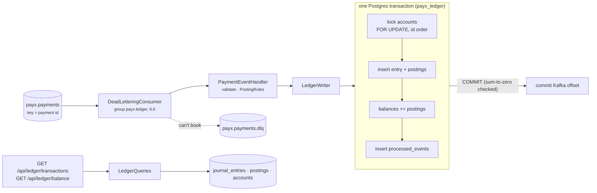

# PayX — Ledger and wallets (Phase 7)

*As of 2026-11-09 · Modules 7.1–7.7, commits `a33b830` … `367be52`.*

Phase 7 builds the books. Every payment event that Phase 6 publishes is
booked into a **double-entry, append-only journal**. Balances are kept **in
the same transaction** as the postings, so the "wallet" can never disagree
with its own history. Customers and merchants read their history and
balances straight from those books. This answers the doc's "wallet and
ledger" section and two functional requirements, *transaction history* and
*balance management*. It also delivers rule 2 in full: "a message is only
marked as consumed after the transaction is … recorded in the wallet and
ledger".

**Contents:** [The big picture](#the-big-picture) ·
[7.1 Double entry](#71-double-entry) ·
[7.2 Append-only](#72-append-only) ·
[7.3 Consumer](#73-the-consumer) ·
[7.4 Dedupe](#74-idempotent-consumer) ·
[7.5 Balances](#75-balances-in-the-same-transaction) ·
[7.6 History](#76-gettransactionhistory) ·
[7.7 Balance API](#77-balance-api) ·
[Scenarios](#scenarios) · [Found while building](#found-while-building) ·
[Configuration](#configuration) · [Known gaps](#known-gaps)

Related: [`RELIABILITY.md`](RELIABILITY.md) (Phase 6: how the events get
here), [`../README.md`](../README.md) Phase 7 section,
[`../DESIGN.md`](../DESIGN.md) decisions 9, 10, 34–39.

## The big picture



Each guarantee has its own layer:

| Guarantee | How | Module |
| --- | --- | --- |
| Money is never created or destroyed | Every entry's postings sum to 0 per currency, checked in code and by a deferred trigger at COMMIT | 7.1 |
| History never changes | Trigger refuses UPDATE/DELETE/TRUNCATE for everyone; the service's role can't even try | 7.2 |
| Every event is booked | Offset committed only after the booking commits | 7.3 |
| No event is booked twice | `processed_events` in the same transaction, plus one entry per payment step | 7.4 |
| A balance is always its postings' sum | Updated in the same transaction, under a row lock | 7.5 |

## The accounts

Accounts are unique per **(type, owner, currency)** and are opened the first
time something posts to them.

| Type | Owner | Normal side | Holds |
| --- | --- | --- | --- |
| `PspClearing` | system (one per currency) | debit | what the PSP owes us for captured payments |
| `MerchantPending` | merchant | credit | captured, owed to the merchant, not yet settled |
| `MerchantAvailable` | merchant | credit | settled, payable (filled by settlement, Phase 8) |
| `CustomerHolds` | customer | debit | **memo**: amounts on hold on the customer's card |
| `MerchantAuthorized` | merchant | credit | **memo**: authorized, not yet captured |

**Why memo accounts.** An authorization moves no money: the issuer only
reserves it on the card. But customers want to see "on hold", merchants
want to see "authorized", and a void must be able to undo it. Holds are
booked in accounts of their own, so they never mix with real money.

**Signs.** Postings are signed: positive = debit, negative = credit. A
credit-normal account (money we owe) therefore holds a negative number.
The APIs flip it (`DisplayBalanceMinor`), so a merchant owed $30 sees +30.

## 7.1 Double entry

A **journal entry** is one business event ("payment X was captured"),
made of two or more **postings** whose signed amounts sum to zero, per
currency. The postings for each payment step:

```
                       CustomerHolds  MerchantAuthorized  PspClearing  MerchantPending
Authorized  (A)             +A              −A
Captured    (A, C ≤ A)      −A              +A                +C            −C
Voided      (A)             −A              +A
```

A capture releases the **whole** hold and books what was taken: authorize
$50, capture $30 → the $50 hold is gone, $30 is owed by the PSP and owed
to the merchant. (One capture per authorization, as at the PSP.)

**Enforced twice:**

1. In code: `JournalEntry.EnsureBalanced` refuses fewer than two legs, a
   zero leg, or any currency whose legs don't sum to zero. $10 and €10
   never cancel.
2. In the database: a **deferred constraint trigger** (`ck_entry_balanced`)
   on `postings` and `journal_entries` checks every entry **at COMMIT**.
   It is deferred because the rows go in one at a time, so the sum is
   briefly non-zero mid-transaction. Only the finished entry has to
   balance. It also refuses an entry with no postings at all.

A composite foreign key `(account_id, currency) → accounts(id, currency)`
stops a USD posting from landing in a EUR account. Nothing cascades on
delete.

**Verified:** raw SQL that bypasses the code: postings +5,000 / −4,999 →
refused at commit (`check_violation`, `ck_entry_balanced`); an entry with
no postings → refused; a EUR posting on a USD account → foreign key
violation.

## 7.2 Append-only

Doc: "immutable entry … auditable trail". Two independent locks:

| Lock | Stops | How |
| --- | --- | --- |
| Trigger `ledger_refuse_change` | everyone, **the owner included** | BEFORE UPDATE/DELETE (row) and BEFORE TRUNCATE (statement) on `journal_entries` and `postings`; DELETE/TRUNCATE on `accounts`. Raises `restrict_violation`: "post a reversing entry instead" |
| Grants | the running service | The service logs in as **`payx_ledger_app`** (SELECT/INSERT only). Migrations run as the owner `payx_ledger` (`ConnectionStrings:LedgerMigrations`) |

**Why both.** The owner can `ALTER TABLE … DISABLE TRIGGER`. So if the
service ran as the owner, the trigger would be one statement away from
any bug or injected SQL. Grants alone would let anyone with the owner's
password quietly "fix" a posting. A mistake is corrected the accountant's
way, with a reversing entry (Phase 9).

The role is created by the Postgres init script for a fresh volume, or by
[`infra/postgres/upgrade/07-ledger-app-role.sql`](../infra/postgres/upgrade/07-ledger-app-role.sql)
(idempotent) for an existing one.

**Verified:** as `payx_ledger_app`, UPDATE/DELETE on postings and entries →
`insufficient_privilege`. As the owner → `restrict_violation` from the
trigger. TRUNCATE of any ledger table → refused.

## 7.3 The consumer

`PaymentEventHandler` runs inside the 6.6 loop (`DeadLetteringConsumer`,
group `payx-ledger`). The loop commits the Kafka offset only after the
handler returns, and the handler returns only after the booking's
transaction has committed. A crash in between means the event is read
again: **at least once**, never at most once.

| Event | Booked |
| --- | --- |
| `Authorized` | hold (Authorization entry) |
| `Captured` | release + capture (Capture entry, 4 postings) |
| `Voided` | release (Void entry) |
| `RiskApproved`, `RiskBlocked`, `Challenged`, `Declined`, `Unknown`, `Failed` | nothing: no money moved |
| a status the Ledger doesn't know | nothing, with a warning (a newer Payment) |

**Validation on read.** System.Text.Json fills a missing field with
null/0 rather than failing, and a ledger must never book a silent zero.
So `Read` checks every required field: ids, amount, sequence, a capture's
amount, captured ≤ authorized, and a known currency. Anything wrong is a
`PoisonMessageException` and goes to the dead-letter topic at once.

**Missing predecessor.** A capture or void whose authorization isn't in
the books (dead-lettered, or older than the topic's retention) is **not
guessed**. It throws, is retried, then parked in the DLQ next to its
predecessor, to be replayed after it. Booking it anyway would release a
hold that was never placed.

**Shared serializer.** `PaymentEvent.Json` (in `PayX.Contracts`) is now the
one way the event is written (Payment's outbox) and read (Ledger), so the
two can't drift.

**Verified live:** the new group read the whole retained topic (1,776
events), lag 0, DLQ empty, every entry balanced. Payment
`pay_01a1bedc…` (authorize $50, capture $30) matches its two entries
exactly.

## 7.4 Idempotent consumer

At-least-once means the same event *will* arrive twice: after a crash
before the commit, a rebalance, or a replay from the DLQ or from an
offset reset. Two guards:

1. **`processed_events` (the inbox).** The event id is inserted **in the
   same transaction** as the entry, so "booked but not marked" can't
   happen. A redelivery is skipped up front (`Duplicate`). Two
   simultaneous deliveries both pass that check, and the primary key lets
   only one commit; the loser reports `Duplicate`, not an error. Each row
   points at the entry it produced, so an auditor can trace a booking
   back to its event.
2. **One entry per payment step.** A partial unique index allows one
   `Authorization`, `Capture` and `Void` per payment. A replay minted with
   a new event id books nothing either (`StepAlreadyBooked`, logged as a
   warning). The index is partial because refunds (Phase 9) may repeat.

Neither outcome is retried. The books already hold the step, so
acknowledging the message is exactly right.

**Verified live, the replay drill:** the `payx-ledger` group was reset to
the earliest offset and the whole topic replayed, twice.

- First replay: 0 duplicate steps. 528 events were recognised by the
  business key (booked by 7.3 before `processed_events` existed). 26 were
  genuinely new.
- Second replay: 674 entries before and after. The 26 booked after 7.4
  were caught by event id.

## 7.5 Balances in the same transaction

**DESIGN decision 10, a deliberate deviation from the doc.** The doc
updates the wallet, then appends to the ledger. That is two writes, and a
crash between them leaves a balance that disagrees with its own history,
with nothing to say which is right. Here everything is one transaction:

```
BEGIN
  already processed?            → yes: Duplicate, stop
  lock accounts FOR UPDATE      (in id order)
  insert entry + postings
  account.balance += posting    (for each leg)
  insert processed_events
COMMIT                          (deferred sum-to-zero trigger runs here)
```

**Why the row lock.** "balance = balance + amount" is read-modify-write.
Two consumers booking on the same account both read 100 and both write
100 + their amount, so one booking vanishes from the balance while its
postings stay. **Measured:** with `FOR UPDATE` removed, 25 concurrent $10
captures to one merchant left a balance of **$50 instead of $250**. With
the lock, it was $250 every time.

**Why id order.** Two bookings that touch the same two accounts then queue
instead of each holding one and waiting for the other (a deadlock).

**An EF Core trap.** A query returns an already-tracked entity as it is,
not with the values it just read. A context that loaded an account
earlier would keep a stale balance even under the lock. `LockAsync`
detaches those first.

**Least privilege, again.** The service gets a column grant,
`UPDATE (balance_minor) ON accounts`: it can move a balance, but it can't
retype an account or give it to another owner.

**Checks** (`BalanceAudit`): accounts whose balance ≠ the sum of their
postings, and the **trial balance** per currency, which must be 0. **Live:**
0 mismatched accounts, USD trial balance 0.

**Trade-off: the hot account.** Every capture locks the one `PspClearing`
row for its currency, so captures serialize on it. The lock is held for
milliseconds, which is fine for ~1,400 TPS peak on one Postgres. The
production fixes are to shard the clearing account (N sub-accounts,
summed on read), or to post to it in batches.

## 7.6 getTransactionHistory

`GET /api/ledger/transactions?from=&to=&before=&limit=` (through the
Gateway, Customer or Merchant token). Returns the caller's own entries,
newest first: a customer sees what they paid, a merchant what they were
paid. **Who the caller is comes from the token only**; there is no
parameter to ask for someone else's history.

**Keyset paging.** `before` is the last entry id seen, and the response
carries `nextBefore`. Unlike OFFSET, page 500 costs the same index seek as
page 1 (`(customer_id, id)` / `(merchant_id, id)`), and an entry booked
while the user pages can't shift rows between pages. One extra row is
fetched to know whether another page exists, with no COUNT.

**Verified live:** pay $50, capture $30 → both parties see `Capture 30.00`,
then `Authorization 50.00`. Each event was booked ~0.5–0.8 s after it
happened (outbox relay → Kafka → consumer). Another merchant sees nothing;
no token → 401; `from` ≥ `to` → 400.

## 7.7 Balance API

`GET /api/ledger/balance`, read from the stored balances (one row per
account, whatever the history's length):

| Caller | Per currency |
| --- | --- |
| Merchant | `authorized` (held on cards, not captured) · `pending` (captured, not settled) · `available` (settled, payable) |
| Customer | `onHold` |

`available` stays 0 until settlement (Phase 8) moves money from pending.
That is the doc's "available vs pending" distinction: captured money isn't
payable until the PSP has actually paid it. Currencies are never added
together.

**Verified live:** after paying $50 and capturing $30, the merchant has
authorized 0 / pending 30.00 / available 0, and the customer has 0 on hold.

## Scenarios

| # | Scenario | What happens | Module |
| --- | --- | --- | --- |
| L1 | Code tries to book an unbalanced entry | Refused before the database; a raw INSERT is refused at COMMIT | 7.1 |
| L2 | A posting in the wrong currency | Foreign key violation | 7.1 |
| L3 | Someone edits or deletes a posting | Service role: no privilege. Owner: trigger refuses | 7.2 |
| L4 | Ledger crashes after booking, before the offset commit | The event is redelivered; `processed_events` skips it | 7.3–7.4 |
| L5 | Ledger crashes mid-booking | Transaction rolls back whole; the offset isn't committed; redelivered and booked once | 7.3 |
| L6 | Two instances get the same event (rebalance) | One commits; the other's primary-key violation → Duplicate | 7.4 |
| L7 | Replay of the whole topic | Nothing booked twice (event id, then business key) | 7.4 |
| L8 | Malformed or impossible event | Dead-lettered at once with the reason | 7.3 |
| L9 | Capture arrives without its authorization | Retried, then dead-lettered; never guessed | 7.3 |
| L10 | Many captures to one merchant at once | Row lock: balance exact | 7.5 |
| L11 | Balance and postings disagree | Can't happen through the code; `BalanceAudit` finds it if anything else does | 7.5 |
| L12 | A customer pages through history while new payments land | Keyset cursor: no gaps, no repeats | 7.6 |
| L13 | A merchant asks for another merchant's data | There is no parameter for it: own rows only | 7.6–7.7 |

## Found while building

| Finding | Fix |
| --- | --- |
| The 6.6 consumer disposed its Kafka consumer without `Close()`: a stopped instance never left the group, and its partitions stayed unassigned for the ~45 s session timeout on **every deploy** (the offset reset in the 7.4 drill was refused: group still `PreparingRebalance`) | `Close()` in a `finally`; after the fix the group is `Empty` the moment the container stops |
| Deploy order: a migration adding `balance_minor` while the old Ledger kept booking would leave new postings without balances | Stop the consumer, migrate (with a backfill from postings), start the new version. In production: expand/contract, or the migration as a deploy step before the new consumer starts |
| `SqlQuery<T>` maps by the snake_case convention too | Aliases `account_id`, not `"AccountId"` |
| `TRUNCATE … CASCADE` takes exclusive locks before its trigger runs, and deadlocked with concurrent bookings (40P01), both from parallel tests and from the live container during a full test run | Serial test collection, plus a retry on deadlock (a victim truncated nothing) |

**Repairing drifted balances** (the dev database after the no-lock
experiment): rebuild the projection from the truth, as the owner. Postings
are untouched, so append-only still holds:

```sql
UPDATE accounts a SET balance_minor = s.total
FROM (SELECT a2.id, coalesce(sum(p.amount_minor), 0) AS total
      FROM accounts a2 LEFT JOIN postings p ON p.account_id = a2.id GROUP BY a2.id) s
WHERE s.id = a.id AND a.balance_minor <> s.total
RETURNING a.id, a.type, a.balance_minor;
```

## Configuration

| Setting | Default | Meaning |
| --- | --- | --- |
| `ConnectionStrings:Ledger` | `payx_ledger_app` @ 5434 | the service's own login: SELECT/INSERT, `UPDATE (balance_minor)` |
| `ConnectionStrings:LedgerMigrations` | `payx_ledger` @ 5434 | the owner; migrations only (local dev, at startup) |
| `Kafka:BootstrapServers` | `localhost:9094` (containers `kafka:9092`) | broker |
| `Kafka:Consumer:MaxAttempts` / `RetryDelay` | 5 / 200 ms | in-place retries before dead-lettering (6.6) |
| consumer group | `payx-ledger` | reset it to replay (stop the Ledger first) |
| Gateway route | `/api/ledger/**`, policy `ledger` (Customer, Merchant) | port 7085 |

## Known gaps

| Gap | Effect | Planned |
| --- | --- | --- |
| `MerchantAvailable` is never filled | `available` is always 0 | settlement, Phase 8 |
| Refunds and chargebacks | no reversing entries yet | Phase 9 (the unique index is already partial for them) |
| Hot `PspClearing` row | captures serialize on one row per currency | shard the account, or batch, if load demands (11.10) |
| `processed_events` grows forever | one row per booked event | prune after the topic's retention: an older event can't be redelivered anyway |
| No fees account | merchant pending = full captured amount | when pricing exists |
| Missing-predecessor events need a manual replay order | authorized before captured | the Phase 11 replay tool |
| Ops can't run `BalanceAudit` through an API | psql only | ops console with reconciliation (Phase 8, 10.5) |
