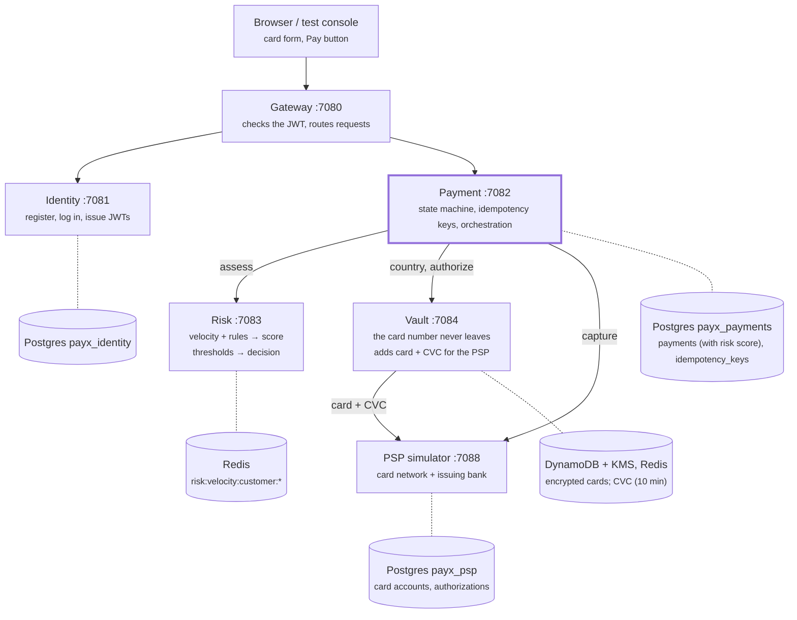
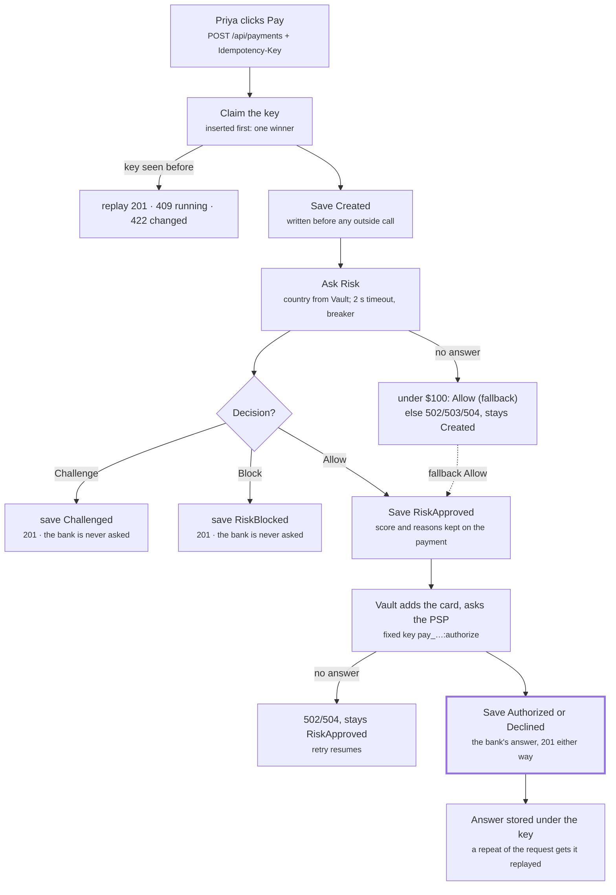
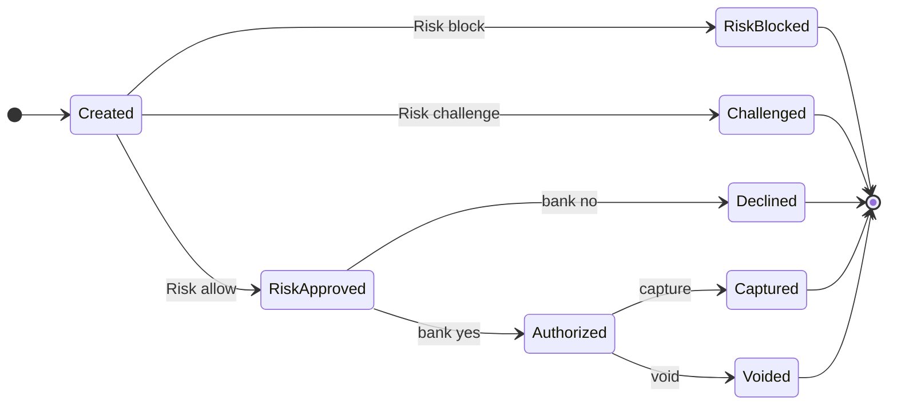
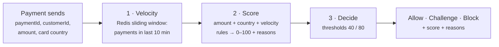
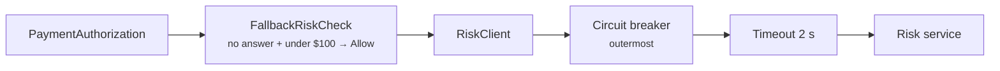
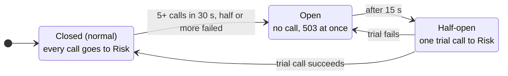

# PayX — Payment Core & Risk Design

*As of 2026-11-06 · Phase 4 (Payment Core) and Phase 5 (Risk), up to commit `3496a3c`.*

PayX checks every card payment for fraud before it asks the bank for money,
and stays safe to retry at every step.

**Contents:** [Overview](#overview) · [Architecture](#architecture) ·
[Payment flow](#payment-flow-authorize) · [Payment states](#payment-states) ·
[Idempotency](#idempotency-why-a-retry-never-charges-twice) ·
[How Risk works](#how-risk-works) ·
[Resilience](#resilience-timeout-circuit-breaker-fallback) ·
[All scenarios](#all-scenarios) · [Configuration](#configuration-reference) ·
[Known gaps](#known-gaps-and-what-comes-next)

**Since Phase 6:** two more statuses, `Unknown` (the bank didn't answer in
time; answered 202) and `Failed` (the PSP has no record), plus the outbox,
retries, resolver and dead-letter topic: see [`RELIABILITY.md`](RELIABILITY.md).

Related: every Payment Core scenario with its requests in
[`PAYMENT-CORE.md`](PAYMENT-CORE.md); module-by-module teaching notes in
[`../README.md`](../README.md); decisions and failure modes in
[`../DESIGN.md`](../DESIGN.md).

## Overview

**Payment Core** lets a customer pay a merchant by card in two steps, as card
networks work: **authorize** reserves the money on the card, **capture** moves
it later (typically when the order ships). Either party can check a payment's
status.

**Risk** scores each payment before authorization and decides **Allow**,
**Challenge** (the customer must prove it's them) or **Block**. A challenged or
blocked payment never reaches the bank.

Three rules shape everything:

| Rule | How it is enforced |
| --- | --- |
| Never move money twice | An idempotency key on every money-moving call, forwarded hop by hop to the bank |
| Write before you call | The payment is saved before every outside call, so a crash always leaves a record of how far it got |
| A dependency's trouble must not become an outage | Timeout, circuit breaker and fallback around Risk; retryable errors that resume the same payment |

The card number never leaves **Vault**. Every other service sees only a token,
brand, last 4 digits and issuing country.

## Architecture

Six services, each owning its own data; no service reads another's store.
Payment is the orchestrator: it drives every step of a payment and records
each result before the next call.



Solid arrows are HTTP calls, dotted lines a service's own store. Risk and
Vault have no Gateway route: only Payment calls them (the Gateway exposes
Vault's tokenize endpoint alone, for checkout).

| Service | Port | Owns | Role |
| --- | --- | --- | --- |
| Gateway | 7080 | — | single entry point; checks the JWT |
| Identity | 7081 | Postgres `payx_identity` | users, passwords, tokens |
| Payment | 7082 | Postgres `payx_payments` | payments, idempotency keys, the flow |
| Risk | 7083 | Redis `risk:*` | score and decision |
| Vault | 7084 | DynamoDB `payx-card-vault`, Redis `vault:*`, KMS key | card numbers, CVCs, the PSP's answers |
| PSP simulator | 7088 | Postgres `payx_psp` | stands in for the card network and the issuing bank |

## Payment flow: authorize

One `POST /api/payments` runs these steps in order. Each step runs only if the
payment is in the state that step starts from, which is what lets a retry
resume the same payment.



The main column is the happy path; every side box is an exit. Exits with a
5xx store nothing under the key, so the next retry with the same key picks up
where the payment stopped.

**Capture** is shorter: the merchant calls `POST /api/payments/{id}/capture`
with its own key. Payment checks the request first (right merchant,
`Authorized`, amount within the hold) and only then calls the PSP directly with
`{paymentId}:capture`. No card data is involved, so Vault is skipped. A refusal
never reaches the PSP.

## Payment states

A payment's status changes only through its own methods (`ApproveRisk`,
`ChallengeRisk`, `Authorize`, `Capture`…), and each one checks a single table
of legal moves first. Postgres check constraints refuse impossible rows as a
second line of defence.



Every payment ends in one of five final states; moves only go forward, and the
code refuses any other move.

| State | Meaning | Reached by |
| --- | --- | --- |
| `Created` | saved before any outside call | the first request with a new key |
| `RiskApproved` | Risk allowed it, or the fallback did; the bank hasn't answered yet | Risk: Allow |
| `RiskBlocked` | Risk refused it | Risk: Block |
| `Challenged` | the customer must prove it's them; completing that isn't built yet | Risk: Challenge |
| `Authorized` | the bank reserved the amount on the card | the bank said yes |
| `Declined` | the bank said no; nothing is held | the bank said no |
| `Captured` | the merchant took all or part of the hold | merchant capture |
| `Voided` | the hold was released | void (domain only so far) |

A payment stuck at `Created` or `RiskApproved` means a call got no answer.
Today only a retry with the same key moves it on; Phase 6 adds a resolver for
payments nobody comes back for.

## Idempotency: why a retry never charges twice

Every hop that can move money carries a key, and each hop derives a stable key
for the next, so a repeat is recognised all the way to the bank.

| Hop | Key | Made by | Stored where |
| --- | --- | --- | --- |
| Browser → Payment | `checkout-…`, one per checkout | the client | Postgres `idempotency_keys` (caller, key) |
| Payment → Vault → PSP (authorize) | `{paymentId}:authorize` | Payment, fixed per payment | Vault: Redis `vault:answer:*` (24 h); PSP: its own key table |
| Payment → PSP (capture) | `{paymentId}:capture` | Payment | PSP key table |
| Payment → Risk | none needed | — | Risk counts velocity by payment id, so a repeat is harmless |

**How Payment uses its key** (`IdempotencyFilter` + `IdempotencyService.ClaimAsync`):

1. **Insert first.** The key row is inserted and committed before any work. The
   primary key decides who was first, so of two simultaneous clicks exactly one
   wins.
2. **Same key, same request, finished** → the stored answer is replayed with
   `Idempotent-Replayed: true`. Nothing runs.
3. **Same key, different body** → `422 idempotency_key_reused_with_different_request`.
4. **Same key, still running** (lock held for 30 s) → `409 request_in_progress`
   with `Retry-After: 1`.
5. **Same key, earlier attempt ended in a 5xx or died** → the retry takes the
   key over and **resumes the same payment** from the state it reached.

**Only definitive answers are stored.** Success, decline, challenge, block and
4xx refusals are replayed forever. A 5xx means "no outcome yet", so the key is
released and the next retry finds out what really happened.

**The recovery point.** The payment's id is written onto the key in the same
transaction that creates the payment. A resumed request loads that payment and
runs only the steps it hasn't done: `Created` asks Risk, `RiskApproved` asks
Vault again with the same `{paymentId}:authorize` key, and a finished payment is
simply returned.

## How Risk works

Risk answers one call, `POST /api/risk/assessments`, in three steps: count
recent payments, score with rules, decide with thresholds. Detection (the
score) and decision (the thresholds) are kept apart because fraud analysts
tune the first and the business owns the second.



**Input** (sent by Payment; the country comes from Vault, never from the browser):

```json
{ "paymentId": "pay_…", "customerId": "…", "amountMinor": 600000, "currency": "USD", "cardCountry": "GB" }
```

### Step 1: velocity (real-time signal)

A Redis sorted set per customer, `risk:velocity:customer:{id}`, holds one
member per payment id, timed by Redis's own clock. One Lua script trims
entries older than 10 minutes, adds this payment (`ZADD NX`), refreshes the
key's expiry and counts. The count includes this payment.

It is a **sliding** window: it always looks back the full 10 minutes, so a
burst can't hide across a clock boundary the way it can with fixed 10-minute
buckets. Because the member is the payment id, a retried assessment is counted
once.

### Step 2: score (rules)

| Rule | Fires when | Points |
| --- | --- | --- |
| `amount_high` | amount ≥ high band for its currency ($5,000 for USD) | 50 |
| `amount_elevated` | amount ≥ elevated band ($1,000 for USD) | 20 |
| `amount_unrated` | no bands configured for the currency | 20 |
| `card_country_high_risk` | country on the high-risk list (`XR` in tests) | 60 |
| `cross_border` | country is not the home country (`US`) | 15 |
| `card_country_unknown` | no country known | 15 |
| `velocity_high` | 5 or more payments in 10 minutes | 40 |
| `velocity_elevated` | 3 or 4 payments in 10 minutes | 15 |

Within each group (amount, country, velocity) at most one rule fires. Points
add up and are capped at 100. Every rule that fired is returned as a reason,
even when the cap hides its points.

### Step 3: decision (thresholds)

| Score | Decision | What Payment does |
| --- | --- | --- |
| 0–39 | **Allow** | saves `RiskApproved`, asks the bank |
| 40–79 | **Challenge** | saves `Challenged`; the bank is never asked |
| 80–100 | **Block** | saves `RiskBlocked`; the bank is never asked |

Thresholds that contradict each other (challenge above block) stop Risk from
starting.

### Worked examples

| Payment (fresh customer unless noted) | Reasons | Score | Decision |
| --- | --- | --- | --- |
| $50, US card | none | 0 | Allow |
| $1,500, GB card | amount_elevated + cross_border | 35 | Allow |
| $6,000, GB card | amount_high + cross_border | 65 | Challenge |
| $50, XR card | card_country_high_risk | 60 | Challenge |
| $6,000, XR card | amount_high + card_country_high_risk | 100 | Block |
| $50, US card, 5th payment in 10 min | velocity_high | 40 | Challenge |
| $6,000, US card, 6th payment in 10 min | amount_high + velocity_high | 90 | Block |

Payment stores the score and reasons on the payment (`risk_score`,
`risk_reasons`) for analysts and disputes. The customer's response shows only
the status, so a fraudster can't learn which rule to dodge.

## Resilience: timeout, circuit breaker, fallback

Risk sits on every checkout's path, so its trouble must cost a checkout
seconds at most, never an outage. Three layers handle it, each answering a
different question.

| Layer | Question it answers | Where |
| --- | --- | --- |
| Timeout (2 s) | How long do we wait for one call? | Polly pipeline on Payment's Risk `HttpClient` |
| Circuit breaker | Should we call at all right now? | same pipeline, outside the timeout |
| Fallback | What does the business do meanwhile? | `FallbackRiskCheck`, around the client |



**Why a timeout.** A slow service is worse than a dead one. Each waiting
checkout holds a thread, a database connection and an idempotency lock.
Without a bound (HttpClient's default is 100 s), enough of them take Payment
down although Payment did nothing wrong.

**Why a circuit breaker.** Once Risk is known to be failing, every call still
costs a checkout 2 s and adds load to a service trying to recover. The breaker
counts failures (errors, 5xx and timeouts) and, past the limit, stops calling.



While the circuit is open, the fallback still applies: small payments go
through, larger ones get 503 `risk_circuit_open` instantly instead of waiting
2 s.

**Order matters.** The breaker wraps the timeout, so a timeout counts as a
failure. The other way round, a hung Risk would never trip the breaker.

**The fallback** (decision 12) when Risk gives no answer:

- **Amount under the threshold** (about $100, per currency): allowed. Stored
  with no score and reason `risk_unavailable_fallback`, so it can be reviewed
  later.
- **Anything else, or a currency with no threshold**: the retryable error
  stands (502, 503 or 504). The payment stays `Created`, and the customer's
  retry with the same key resumes it.

Neither extreme works: allowing everything turns a Risk outage into a fraud
window (fraudsters watch for outages), and refusing everything turns it into a
checkout outage. A large payment isn't blocked for good either, because Risk
never judged it.

**Measured** (Risk container paused): four $500 payments got 504 after about
2 s each, the 5th and 6th got 503 in 0.03 s, a $50 payment was authorized via
the fallback in 0.08 s, and 16 s after unpausing everything was normal.

## All scenarios

Every scenario below was run through the Gateway or covered by tests. Status
codes are what the customer or merchant receives.

### Paying

| # | Scenario | Answer | Bank called? |
| --- | --- | --- | --- |
| P1 | Tokenize a card at checkout | 201, `tok_…` with brand, last 4, country | no |
| P2 | Pay, risk allows, bank approves | 201 `Authorized` | yes |
| P3 | Pay, bank declines (test cards …0002, …9995, …0069, …0127) | 201 `Declined` + reason | yes |
| P4 | Pay again with the same key (lost response) | 201, same payment, `Idempotent-Replayed` | no |
| P5 | Double-click: two requests, same key, same moment | one 201 + one 409 `request_in_progress` | once |
| P6 | Same key, different amount | 422 `idempotency_key_reused_with_different_request` | no |
| P7 | No `Idempotency-Key` header | 400 `idempotency_key_required` | no |
| P8 | Unsupported currency (`XYZ`) | 400 on `amount.currency` | no |
| P9 | New payment with a used card token (CVC gone) | 422 `cvc_unavailable` | no |
| P10 | Bank unreachable, then retry with the same key | 502 `psp_unreachable`, then 201 `Authorized`, same payment | once |
| P11 | Process dies after the bank said yes; retry after 30 s | Vault replays the bank's stored answer: `Authorized`, one hold | once |

### Risk decisions

| # | Scenario | Answer | Bank called? |
| --- | --- | --- | --- |
| R1 | $50, US card | 201 `Authorized` (score 0) | yes |
| R2 | $6,000, GB card | 201 `Challenged` (65) | no |
| R3 | $50, XR card | 201 `Challenged` (60) | no |
| R4 | $6,000, XR card | 201 `RiskBlocked` (100) | no |
| R5 | 5th payment by one customer in 10 minutes | velocity +40: Challenge or Block sooner | depends |
| R6 | Risk assesses the same payment twice | counted once in velocity | — |

### Risk in trouble

| # | Scenario | Answer | Bank called? |
| --- | --- | --- | --- |
| T1 | Risk down (connection refused), $500 | 502 `risk_unreachable`; payment stays `Created` | no |
| T2 | Risk slow (frozen), $500 | 504 `risk_timeout` after 2 s | no |
| T3 | Risk keeps failing: 5+ calls in 30 s, half failed | 503 `risk_circuit_open` in milliseconds, for 15 s | no |
| T4 | Risk unavailable, payment under $100 | 201 `Authorized` via fallback, score empty, reason `risk_unavailable_fallback` | yes |
| T5 | Risk back, retry with the same key | the same payment continues from `Created` | yes |
| T6 | Vault can't say the card's country | Risk scores it as unknown (+15): stricter, never looser | — |
| T7 | Risk's Redis down | Risk not ready, assessments fail → T3/T4 apply | — |

### After authorization

| # | Scenario | Answer | Bank called? |
| --- | --- | --- | --- |
| A1 | Status as the customer or the merchant | 200 | no |
| A2 | Status as another merchant | 404 `payment_not_found` (not 403: it must not learn the payment exists) | no |
| A3 | Merchant captures all or part | 200 `Captured` | yes |
| A4 | Capture more than authorized | 422 `amount_exceeds_authorized` | no |
| A5 | Capture twice: same key / new key | replayed 200 / 409 `payment_not_capturable` | no |
| A6 | Customer tries to capture | 403 | no |
| A7 | Capture a Declined, Challenged or Blocked payment | 409 `payment_not_capturable` | no |
| A8 | Bank down during capture, then retry | 502, then 200 `Captured`; the bank shows one capture | once |

## Configuration reference

Policy lives in configuration so it can change without a deploy. Risk reads
its settings through `IOptionsMonitor`, so edits apply to the next request.

| Setting | Service | Default | Meaning |
| --- | --- | --- | --- |
| `Risk:Rules:AmountBands:{CUR}` | Risk | USD 100000 / 500000 | elevated / high amount, minor units |
| `Risk:Rules:HomeCountry` | Risk | `US` | cards from elsewhere are cross-border |
| `Risk:Rules:HighRiskCountries` | Risk | `["XR"]` | ISO codes scored as high risk |
| `Risk:Rules:Velocity` | Risk | 10 min, 3, 5 | window, elevated count, high count |
| `Risk:Decision` | Risk | ChallengeAt 40, BlockAt 80 | the business's risk appetite; checked at startup |
| `Risk:Timeout` | Payment | 2 s | longest wait for Risk |
| `Risk:CircuitBreaker` | Payment | 0.5, 5, 30 s, 15 s | failure ratio, minimum calls, sampling window, break length |
| `Risk:Fallback:AllowBelowMinor:{CUR}` | Payment | USD 10000 ($100) | below this, a payment may skip an unavailable Risk |
| `Payment:IdempotencyLock` | Payment | 30 s | how long a running request holds its key |
| `Vault:Timeout` / `Psp:Timeout` | Payment | 15 s / 10 s | Vault waits 10 s for the PSP, so Payment waits longer |
| `Vault:CvcTtl` | Vault | 10 min | longest a CVC is held |

## Known gaps and what comes next

| Gap | Effect today | Planned |
| --- | --- | --- |
| No 3-D Secure flow | `Challenged` is final; the customer can't complete the challenge | deferred |
| Velocity per customer only | a fraudster with many accounts and one card isn't caught | card fingerprint from Vault |
| Risk keeps no decision history | only Payment's row holds the score | `payx-risk-decisions` table |
| Vault country lookup not bounded by 2 s | a slow Vault still delays checkout up to 15 s | small follow-up |
| No resolver for stuck payments | a payment left at `Created` or `RiskApproved` with no retry stays there | Phase 6: `UNKNOWN` state and resolver job |
| No events yet | the ledger can't learn about payments | Phase 6: outbox and Kafka |
| Fallback approvals not re-scored | small payments approved during an outage aren't checked later | review job |
