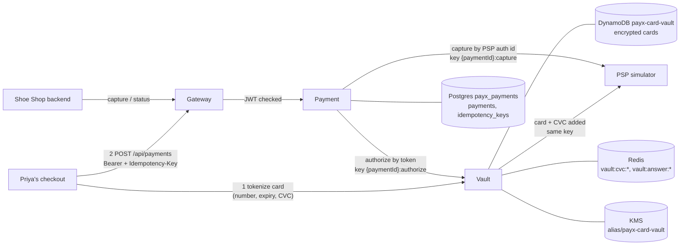
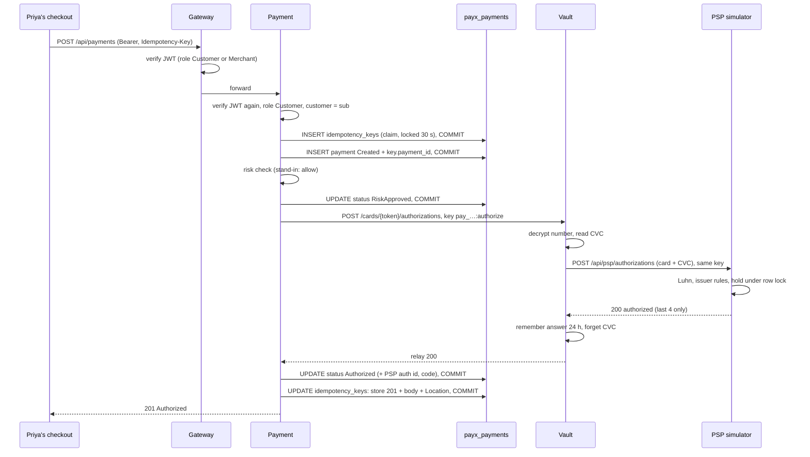
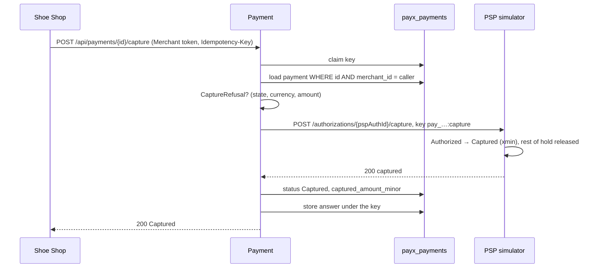

# PayX — Payment Core, scenario by scenario

> What Phase 4 built (Modules 4.1–4.7), told as the scenarios it handles.
> Each scenario gives the **API calls**, the **backend logic** step by step,
> **what is written where**, and **what the customer or shop sees**. Every
> scenario here was run end to end against the real services; the module
> that built or verified it is in brackets.
>
> Decisions behind it: [`DESIGN.md`](../DESIGN.md) §1, decisions 3, 6, 7 and
> 28–33. How to run it: [`RUNNING.md`](../RUNNING.md). Teaching notes per
> module: [`README.md`](../README.md), Phase 4.

The cast, used throughout:

- **Priya**, a customer (role `Customer`).
- **Shoe Shop**, a merchant (role `Merchant`). Its user id is the `merchantId`.
- **PayX**: Gateway (:7080), Identity (:7081), Payment (:7082), Vault (:7084).
- **The PSP simulator** (:7088), playing Stripe/Adyen, the card network and
  Priya's bank.

---

## 1. The moving parts



| Service | What it owns | What it never sees |
|---|---|---|
| Gateway | routing, token check at the edge | — |
| Payment | the payment's state, idempotency keys | card numbers, CVCs |
| Vault | encrypted cards, CVCs (briefly), PSP answers it relayed | payment state |
| PSP simulator | its own holds and captures | PayX's internals |

### The payment's life (state machine, Module 4.1)

```
Created ──risk──► RiskApproved ──PSP yes──► Authorized ──capture──► Captured
   │                   │                         └────────void─────► Voided   (no endpoint yet)
   └──► RiskBlocked    └──PSP no──► Declined
```

Only these moves exist; everything else is refused in code
(`IllegalTransitionException`) and inconsistent rows are refused by the
database (check constraints). Blocked, Declined, Captured and Voided are
final.

### The idempotency key chain (Modules 4.5–4.7)

One click of "Pay" carries one key, and every hop turns it into a key of
its own that is stable across retries:

```
Priya's Idempotency-Key "checkout-7f3a"            (chosen by the checkout page, once per checkout)
   └─ Payment: idempotency_keys(scope = Priya's id, key = "checkout-7f3a")
        └─ recovery point: payment_id = pay_01A…   (written in the same transaction as the payment)
             └─ Vault + PSP key: "pay_01A…:authorize"
                  ├─ Vault: vault:answer:{token}:pay_01A…:authorize   (the PSP's answer, 24 h)
                  └─ PSP:   idempotency_keys("pay_01A…:authorize")    (the PSP's own dedupe)
```

A retry at any level lands on the same row at the next level down, so
nothing runs twice and nothing is lost.

---

## 2. Checkout: Priya enters her card

**Built in:** 3.6, 3.7, 4.2a

```http
POST http://localhost:7084/api/vault/cards
Content-Type: application/json

{ "number": "4242 4242 4242 4242", "expMonth": 12, "expYear": 2030, "cvc": "123" }
```
```http
201 Created
Location: /api/vault/cards/tok_9f1c…
{ "token": "tok_9f1c…", "brand": "visa", "last4": "4242", "expMonth": 12, "expYear": 2030 }
```

**Backend (Vault, `CardVault.TokenizeAsync`):**

1. Validate: digits only, 12–19 long, Luhn check. A bad number → **400
   `invalid_number`** (the number is never echoed back). Unknown fields
   (e.g. a misspelt `cvv`) → 400.
2. Create the token first: `tok_` + 128 random bits. Random, so it reveals
   nothing and can't be recomputed from a card list.
3. **CVC**, if given: encrypt it (KMS data key, record id `{token}:cvc`) and
   keep it in Redis as `vault:cvc:{token}` for **10 minutes**. It never goes
   to DynamoDB. Done before the card is stored: if storing the card fails,
   only a self-expiring CVC is left behind.
4. **Card number**: KMS `GenerateDataKey` → AES-256-GCM locally → store the
   ciphertext, the wrapped key and the key's ARN in DynamoDB
   `payx-card-vault` under the token (conditional put: never overwrites).
   Brand, last 4 and expiry are stored in the clear for display.

**What Priya sees:** "Visa •••• 4242". From here on, every other service
handles `tok_9f1c…`, never her number.

> Today the checkout calls Vault directly on :7084 (no Gateway route yet);
> the checkout page in Phase 10 decides how the browser reaches it.

---

## 3. Priya pays, and the bank approves

**Built in:** 4.2b, 4.2c, 4.5

```http
POST http://localhost:7080/api/payments
Authorization: Bearer <Priya's access token>
Idempotency-Key: checkout-7f3a
Content-Type: application/json

{ "merchantId": "01a1…shoeshop", "amount": { "amountMinor": 5000, "currency": "USD" }, "cardToken": "tok_9f1c…" }
```
```http
201 Created
Location: /api/payments/pay_01A…
{ "id": "pay_01A…", "status": "Authorized", "merchantId": "01a1…shoeshop",
  "amount": { "amountMinor": 5000, "currency": "USD" },
  "authorizationCode": "VKMLP8", "declineCode": null, "capturedAmountMinor": null,
  "createdAt": "…", "updatedAt": "…" }
```



**Backend, step by step:**

| # | Where | What happens | Written |
|---|---|---|---|
| 1 | Gateway | JWT checked (signature via Identity's JWKS, `iss`, `aud`, `exp`, ES256 only); `/api/payments/**` needs Customer or Merchant | — |
| 2 | Payment | JWT checked again; this endpoint needs **Customer**; the customer id is the token's `sub`, never a body field | — |
| 3 | Payment `[Idempotent]` | Key required; request hash = SHA-256(method, path, arguments); **claim** = INSERT, committed on its own | `idempotency_keys` row, locked 30 s |
| 4 | `PaymentAuthorization` | Amount validated (positive, supported currency) → **save the payment before calling anyone**, and attach its id to the key in the **same** transaction | `payments` row `Created`; `idempotency_keys.payment_id` |
| 5 | | Risk: today a stand-in that always allows (Phase 5 replaces it) | status `RiskApproved` |
| 6 | `VaultClient` → Vault | Authorize by token, key `{paymentId}:authorize` | — |
| 7 | Vault `CardAuthorizer` | Card looked up (404 if none), stored answer for this key? (replay), CVC read (409 if none), number decrypted, PSP called with the same key | — |
| 8 | PSP | Card network + issuer checks, available credit under a row lock, hold recorded, answer stored under the key | PSP `authorizations`, PSP `idempotency_keys` |
| 9 | Vault | Answer is definitive → remember it (`vault:answer:…`, 24 h), then forget the CVC | Redis |
| 10 | Payment | Status `Authorized`, with the PSP's authorization id (needed later for capture) and the issuer's code | `payments` |
| 11 | Payment `[Idempotent]` | Store the answer (status, body, Location); release the lock | `idempotency_keys` completed |

**What Priya sees:** "Payment successful". $50 is **on hold** on her card;
nothing has moved yet.

---

## 4. The bank declines

**Built in:** 3.1, 4.2c

Same call as §3, with a card the issuer refuses (test card
`4000 0000 0000 0002`, or one with no credit left).

```http
201 Created
{ "id": "pay_01B…", "status": "Declined", "declineCode": "card_declined", "authorizationCode": null, … }
```

**Backend:** identical to §3 up to the PSP, which answers **200 with
`status: declined`**. Payment records `Declined` with the code. The answer
is stored under the key like any other.

**Why 201 and not an error:** the request was fine and was processed; the
bank's answer was "no". An HTTP error would mean "something went wrong,
maybe retry". A decline should never be retried with the same card.

Decline codes from the simulator: `card_declined`, `insufficient_funds`,
`expired_card`, `incorrect_cvc`.

**What Priya sees:** "Your card was declined", with the reason.

---

## 5. Risk blocks the payment

**Built in:** 4.2c (path exists; the stand-in never blocks yet)

**Backend:** after step 4 of §3, `IRiskCheck` answers `Block` → status
`RiskBlocked`, saved, and **the PSP is never called**: no hold, no record
at the bank. Answered `201` with `"status": "RiskBlocked"`.

Covered by a test with a blocking stand-in. In real use from Phase 5, when
the Risk service scores the payment.

---

## 6. Priya double-clicks "Pay"

**Built in:** 4.5

The checkout sends the same `Idempotency-Key` for every click of the same
checkout.

**Case A — the second click arrives after the first finished:**

```http
201 Created
Idempotent-Replayed: true
Location: /api/payments/pay_01A…
{ …byte-for-byte the first answer… }
```

**Case B — both clicks arrive at the same moment:**

| Request | Answer |
|---|---|
| first | `201 Created`, `Authorized` |
| second | `409 request_in_progress`, `Retry-After: 1` |

**Backend:** both try to INSERT the same `(scope, key)`. The primary key
lets exactly one win (10 simultaneous claims → 1 winner, in the tests). The
loser reads the row: still running → 409; finished → replay the stored
answer. The work never runs twice.

**What Priya sees:** one payment, one hold. Checked: 1 row in `payments`,
1 authorization at the PSP.

**Keys belong to their caller:** another customer sending the same key
string gets their own payment.

---

## 7. The same key for a different request

**Built in:** 4.5

Priya's checkout reuses `checkout-7f3a` but changes the amount to $60.

```http
422 Unprocessable Entity
{ "title": "idempotency_key_reused_with_different_request", "status": 422 }
```

**Backend:** the stored request hash differs. Replaying the $50 answer
would be wrong, and so would charging $60 under a key that means "the $50
payment". It's a client bug, so it's refused.

A missing key: **400 `idempotency_key_required`**.

---

## 8. The bank is unreachable during payment, and Priya retries

**Built in:** 4.6, 4.7 — the scenario the whole phase was building to

**First attempt** (PSP down):

```http
502 Bad Gateway
{ "title": "psp_unreachable", "detail": "payment pay_01C… is RiskApproved" }
```

**Backend, first attempt:**

1. Claimed the key, created `pay_01C…` (Created → RiskApproved), attached
   it to the key.
2. Vault tried the PSP: connection refused → **502**. The CVC is **kept**
   (the authorization never completed).
3. Payment: no outcome, so the answer is **not stored**. The key's lock is
   **released**, keeping its recovery point (`payment_id = pay_01C…`).

**Second attempt**, same key, PSP back:

```http
201 Created
{ "id": "pay_01C…", "status": "Authorized", … }
```

**Backend, second attempt:**

1. Claim: the key exists, unfinished, lock released → **taken over** (one
   conditional UPDATE; of 10 retries at once, one wins).
2. The key has `payment_id` → **resume `pay_01C…`**, don't create a new one.
3. The payment is at `RiskApproved`, so risk is skipped (each step runs only
   from its starting state) and Vault is called with the **same** key
   `pay_01C…:authorize`.
4. Vault: no stored answer yet, the CVC is still there → the identical
   request goes to the PSP → authorized → answer remembered, CVC forgotten.
5. `Authorized`, answer stored under Priya's key.

**What Priya sees:** an error, then success on retry. **One payment, one
hold** (checked: 1 row, 1 PSP authorization under `pay_01C…:authorize`).

**Why not just start again?** A new payment would get a new PSP key. If the
first attempt had actually reached the bank (a timeout rather than a refused
connection), Priya would carry **two** holds.

---

## 9. The process dies, or the answer is lost, after the bank said yes

**Built in:** 4.6, 4.7 (verified by tests; can't be triggered by hand yet)

Payment crashes after Vault returned "authorized" but before it saved
`Authorized`, or the answer is lost on the way back.

**Backend on retry (same key):**

1. The key's lock **lapses** after 30 s (nobody released it); the retry
   takes it over and resumes the payment from its recovery point. (Before
   the 30 s are up, retries get 409 `request_in_progress`.)
2. The payment is still `RiskApproved` → Vault is called with the same key.
3. Vault finds its **stored answer** for that key and **replays** it
   (`Idempotent-Replayed`) without calling the PSP. The CVC is already gone,
   and isn't needed.
4. Payment saves `Authorized`. One hold, no second call to the bank.

If the payment had already reached `Authorized` before the crash, the
resumed request returns it as is and calls nobody.

> Without a retry, a payment stuck at `RiskApproved` stays there. Detecting
> and resolving those (`UNKNOWN` state, resolver job) is Phase 6.

---

## 10. Paying again with a used card token

**Built in:** 4.2a, 4.7

Priya's checkout reuses `tok_9f1c…` for a **new** payment (new key) after
the first one was authorized.

```http
422 Unprocessable Entity
{ "title": "cvc_unavailable", "detail": "payment pay_01D… is RiskApproved" }
```

**Why:** the CVC exists only until its authorization completes (PCI DSS
forbids keeping it), and it was used for the first payment. A second
payment needs the card re-entered. (Saved-card payments without a CVC are
not supported yet.)

---

## 11. Checking a payment's status

**Built in:** 4.4

```http
GET http://localhost:7080/api/payments/pay_01A…
Authorization: Bearer <Priya's or Shoe Shop's token>
```
```http
200 OK
{ "id": "pay_01A…", "status": "Authorized", … }
```

| Who asks | Answer |
|---|---|
| Priya (its customer) | 200 |
| Shoe Shop (its merchant) | 200 |
| another merchant or customer | **404 `payment_not_found`** (same as a missing id: no hint it exists) |
| no token | 401 |

**Backend:** reads PayX's own row; never calls the PSP. (Asking the PSP
what really happened to an unresolved payment is the resolver, Phase 6.)

---

## 12. The shop ships and takes the money (capture)

**Built in:** 4.3, 4.5

```http
POST http://localhost:7080/api/payments/pay_01A…/capture
Authorization: Bearer <Shoe Shop's token>
Idempotency-Key: capture-pay_01A…
Content-Type: application/json

{ "amountMinor": 3000 }        ← optional; omit it (or send no body) for the full amount
```
```http
200 OK
{ "id": "pay_01A…", "status": "Captured", "capturedAmountMinor": 3000, … }
```



**Backend:**

1. Only a **Merchant** may call it, and only for **its own** payments.
2. **Every refusal we can predict is checked before calling the PSP**:
   wrong state, more than authorized (and, in code, a currency mismatch,
   which the API can't produce: the amount's currency is the payment's). Otherwise the bank
   could capture something we then refuse to record.
3. Payment calls the PSP **directly**, not through Vault: capture quotes the
   PSP's authorization id and needs no card data.
4. Key `{paymentId}:capture`: a retry can never capture twice.
5. Partial capture: the PSP releases the rest of the hold.

**What Priya sees:** $30 charged; the remaining $20 hold disappears.

---

## 13. Capture refused

**Built in:** 4.3

| Situation | Answer | PSP called? |
|---|---|---|
| Already captured, or Declined / RiskBlocked | 409 `payment_not_capturable` | no |
| More than authorized ($50.01 of $50) | 422 `amount_exceeds_authorized` | no |
| Another shop's payment | 404 `payment_not_found` | no |
| Priya (a customer) tries | 403 | no |
| The PSP itself refuses | 409 with the PSP's code | yes |

In every case the payment stays as it was.

---

## 14. The bank is down when the shop captures

**Built in:** 4.3

```http
502 Bad Gateway
{ "title": "psp_unreachable", "detail": "payment pay_01E… is Authorized" }
```

Then, PSP back, the same capture again:

```http
200 OK
{ "status": "Captured", "capturedAmountMinor": 5000, … }
```

**Backend:** the payment stays `Authorized`; the 5xx isn't stored and the
key is released; the retry sends the same PSP key. Checked: the PSP shows
**one** capture of $50.00.

**Capturing twice with the same key** → the stored 200 is replayed. **With
a new key** → 409 `payment_not_capturable` (it really is already captured).

---

## 15. Reference

### Endpoints

| Method and path | Who | Key required | Answers |
|---|---|---|---|
| `POST /api/vault/cards` (:7084) | checkout | — | 201 token · 400 |
| `GET /api/vault/cards/{token}` (:7084) | internal | — | 200 · 404 |
| `POST /api/vault/cards/{token}/authorizations` (:7084) | Payment only | yes | PSP's answer relayed · 404 · 409 `cvc_unavailable` · 502 · 504 |
| `POST /api/payments` (Gateway) | Customer | yes | 201 Authorized / Declined / RiskBlocked · 400 · 401 · 403 · 409 · 422 · 502 · 504 |
| `GET /api/payments/{id}` (Gateway) | its Customer or Merchant | — | 200 · 401 · 404 |
| `POST /api/payments/{id}/capture` (Gateway) | its Merchant | yes | 200 · 400 · 403 · 404 · 409 · 422 · 502 · 504 |

### Error codes (the `title` of the ProblemDetails body)

| Code | Status | Meaning | Retry? |
|---|---|---|---|
| `idempotency_key_required` | 400 | no `Idempotency-Key` | fix the request |
| `idempotency_key_reused_with_different_request` | 422 | same key, different body or path | use a new key |
| `request_in_progress` | 409 | same key still running | yes, after `Retry-After` |
| `card_not_found` | 422 | unknown card token | no |
| `cvc_unavailable` | 422 | CVC never given, used, or expired | re-enter the card |
| `payment_not_found` | 404 | no such payment *for you* | no |
| `payment_not_capturable` | 409 | not in Authorized | no |
| `amount_exceeds_authorized` | 422 | capture above the authorized amount | fix the amount |
| `psp_unreachable` | 502 | bank not reached; nothing happened there | **yes, same key** |
| `psp_timeout` | 504 | no answer in time; it **may** have happened | **yes, same key** |

The rule behind the last two: **a 5xx is never an outcome**. It isn't
stored, the key is released, and the retry with the same key finds out what
really happened.

### Where things are stored

| Store | Key | Holds | Lifetime |
|---|---|---|---|
| Postgres `payments` | `id` (`pay_…`) | the payment and its state | permanent |
| Postgres `idempotency_keys` | (caller id, key) | request hash, lock, recovery point, stored answer | permanent (cleanup job: later) |
| DynamoDB `payx-card-vault` | token | encrypted card, wrapped key, key ARN, brand, last 4, expiry | permanent |
| Redis `vault:cvc:{token}` | token | encrypted CVC | until its authorization completes, max 10 min |
| Redis `vault:answer:{token}:{key}` | token + key | the PSP's definitive answer | 24 h |
| PSP `authorizations`, `idempotency_keys` | PSP's ids / keys | the bank's side | permanent |

### Known gaps (what Phase 4 doesn't do yet)

| Gap | Effect | Where it's solved |
|---|---|---|
| Risk is a stand-in that allows everything | no fraud check | Phase 5 |
| A payment left at `RiskApproved` with no retry stays there | possible hold with no outcome on our side | Phase 6 (`UNKNOWN`, resolver) |
| No retries / backoff / circuit breaker on outbound calls | one failed call = one error to the user | Phases 5–6 (Polly) |
| No void endpoint | a merchant can't cancel an authorized order | later (PSP already supports void) |
| No events to Kafka on state changes | Ledger doesn't hear about payments yet | Phase 6 (outbox) |
| Saved cards (no CVC) can't pay | each payment needs the card re-entered | not planned yet |
| `idempotency_keys` never cleaned up | table grows | later |
| Raw SQL can skip states (constraints check rows, not moves) | only through hand-written SQL | decision 28 (possible trigger) |
