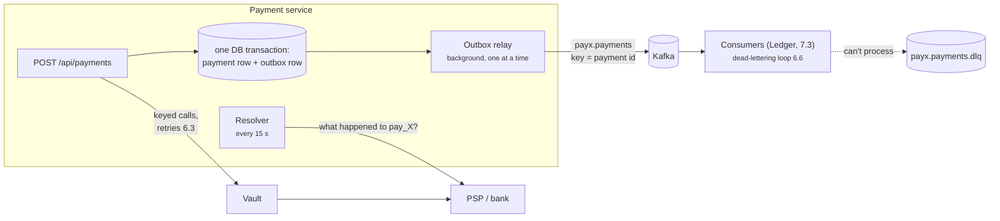
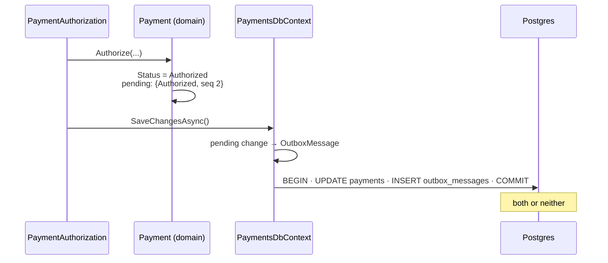
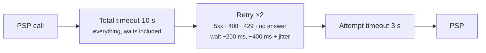
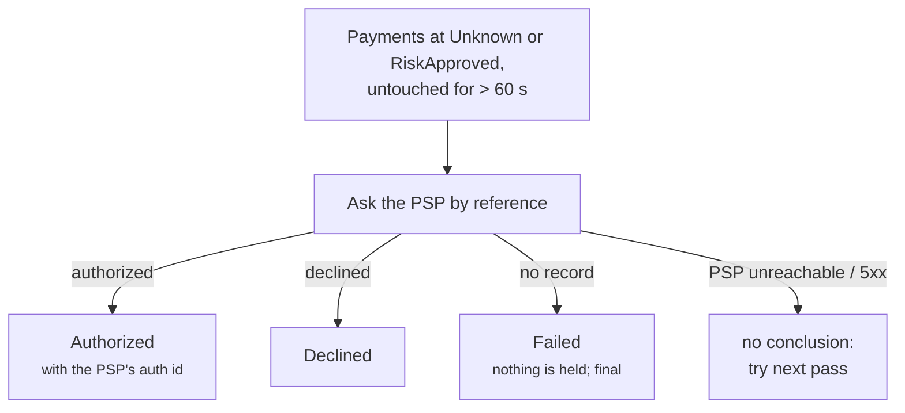
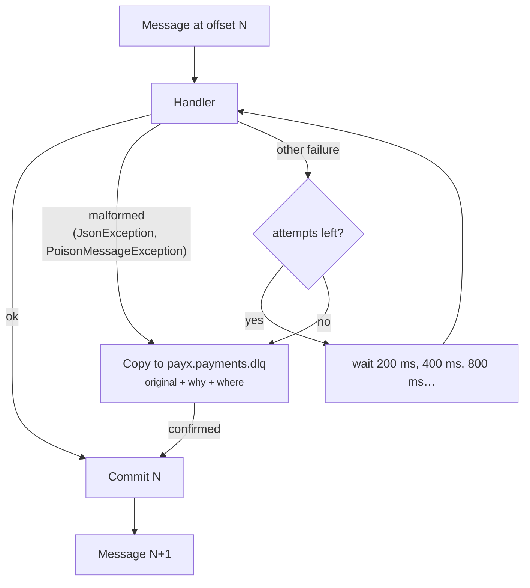

# PayX — Reliability (Phase 6)

*As of 2026-11-08 · Modules 6.1–6.6, commits `17d1b9d` … `8e879f3`.*

Phase 6 makes PayX correct when things fail **after** the customer clicked
Pay: the process crashes, Kafka is down, the bank answers slowly or not at
all, a message can't be processed. It answers the doc's two reliability
questions, *"how do we make sure a completed payment is never lost?"*
(transaction completion) and *"what if the call to the bank fails or times
out?"* (transient failures).

**Contents:** [The big picture](#the-big-picture) ·
[6.1 Outbox](#61-the-transactional-outbox) ·
[6.2 Relay](#62-the-outbox-relay) ·
[6.3 Retries](#63-retries-with-backoff-and-jitter) ·
[6.4 Unknown](#64-the-unknown-state) ·
[6.5 Resolver](#65-the-resolver) ·
[6.6 Dead-letter topic](#66-poison-messages-and-the-dead-letter-topic) ·
[Scenarios](#scenarios) · [Configuration](#configuration) ·
[Known gaps](#known-gaps)

Related: [`PAYMENT-CORE-AND-RISK.md`](PAYMENT-CORE-AND-RISK.md) (Phases 4–5),
[`../README.md`](../README.md) Phase 6 section, [`../DESIGN.md`](../DESIGN.md).

## The big picture

Two problems, six modules:

| Problem | Without Phase 6 | Modules |
| --- | --- | --- |
| **Announcing** a payment: the Ledger (Phase 7) must learn about every authorization and capture, exactly as they happened | A crash between "save the payment" and "publish the event" loses the event (money moved, ledger never knows) or invents one (ledger books money that never moved) | 6.1 outbox, 6.2 relay, 6.6 dead-letter topic |
| **Talking to the bank** when it is slow, failing or silent | A blip fails the payment although a retry would work; a timeout leaves the payment looking "not done" while the card may carry a hold, and nobody ever finds out | 6.3 retries, 6.4 Unknown, 6.5 resolver |



## 6.1 The transactional outbox

**The problem (dual write).** Saving the payment and publishing its event
are two writes to two systems. Whichever goes first, a crash between them
breaks something:

| Order | Crash in between | Result |
| --- | --- | --- |
| publish, then save | event out, save lost | ledger books a capture that never happened |
| save, then publish | save done, event lost | money moved, ledger never hears of it |

**The fix.** Write the event into the **same database, in the same
transaction** as the change: an `outbox_messages` row. Either both commit or
neither does. Publishing happens later (6.2).

**How it is built** (`Domain/Payment.cs`, `Repositories/PaymentsDbContext.cs`):

1. Every status change goes through `Payment.MoveTo`, which records a
   numbered `StatusChange` (sequence 1, 2, 3… per payment).
2. `PaymentsDbContext.SaveChangesAsync` turns each pending change into an
   outbox row (`PaymentEvent` JSON, topic `payx.payments`, key = payment id),
   then saves. EF Core runs one `SaveChanges` in one transaction.
3. No code path writes events itself, so **no code path can forget one**.



**The event** (`PayX.Contracts/Events/PaymentEvent.cs`):

```json
{ "eventId": "0196…", "eventType": "payment.authorized", "paymentId": "pay_…", "sequence": 2,
  "status": "Authorized", "merchantId": "…", "customerId": "…",
  "amount": { "amountMinor": 5000, "currency": "USD" }, "capturedAmountMinor": null,
  "pspAuthorizationId": "auth_…", "occurredAt": "2026-11-08T17:40:12Z" }
```

**Verified:** pay + capture → three rows `payment.riskapproved`,
`payment.authorized`, `payment.captured` in order; a save refused by the
database (risk score 150) writes neither the status nor the event.

## 6.2 The outbox relay

A background worker in Payment (`Jobs/OutboxRelay`, one pass =
`Jobs/OutboxPublisher`) moves outbox rows to Kafka:

1. Take the **relay lock** (`pg_try_advisory_xact_lock`). If another Payment
   instance holds it, skip this pass.
2. Read the oldest unpublished rows (up to 100).
3. Publish each to `payx.payments` with **key = payment id**, and **wait for
   Kafka's confirmation** before the next.
4. Mark the confirmed rows published; commit.

| Design choice | Why |
| --- | --- |
| Key = payment id | Kafka keeps order only within a partition; same key → same partition → one payment's events stay in order (decision 4) |
| One relay at a time (advisory lock) | Two relays each taking a batch could publish a payment's "captured" before its "authorized" |
| Mark only after Kafka confirmed | **At least once**: a crash between publish and mark re-publishes; consumers dedupe by `eventId`. The other order could *lose* an event |
| Producer `acks=all`, idempotent | A confirmed message survives a broker loss; the producer's own retries don't duplicate |
| Request path never touches Kafka | A Kafka outage delays events, never payments |

**Verified live:** Kafka stopped → pay and capture still answered 201 / 200,
three events waited; Kafka started → published within about 12 s.

## 6.3 Retries with backoff and jitter

**Retrying a money-moving POST is normally dangerous**: the first attempt
may have worked and only its answer was lost. PayX can retry because **every
attempt carries the same idempotency key** (`{paymentId}:authorize`,
`{paymentId}:capture`), so the PSP performs the operation once or replays it.

`AddKeyedRetries` (ServiceDefaults) builds this pipeline:



| Rule | Why |
| --- | --- |
| Retry 5xx, 408, 429, connection errors, attempt timeouts | "Not done, try again" |
| Never retry a 4xx or a decline | The same request gets the same "no"; retrying declines looks like card testing |
| Exponential backoff | Gives a struggling PSP room to recover |
| Jitter | Clients that failed together don't retry together (thundering herd) |
| Retry at **one** layer: Vault → PSP and Payment → PSP; Payment → Vault does not retry | Retries at every layer multiply: 3 × 3 × 3 = 27 attempts per click |
| Budgets nest: Vault 10 s < Payment's wait for Vault 15 s < idempotency lock 30 s | The inner layer always answers before the outer one gives up |

**Verified live:** PSP frozen 4 s mid-payment → attempt 1 cut off at 3.0 s,
attempt 2 succeeded → 201 Authorized in 4.4 s; the PSP holds one key.

## 6.4 The Unknown state

When the retry budget runs out without an answer, the bank **may** have
authorized. The doc lists three cases a timeout can hide: the request never
arrived, it arrived and failed, or it succeeded and only the answer was
lost. The caller can't tell them apart.

| Treat a timeout as… | Consequence |
| --- | --- |
| failed | the customer may be charged for a "failed" payment, or retries with a new key and is charged twice |
| succeeded | a sale is recorded that the bank never approved |
| **Unknown** (PayX) | say so, and find out from the only party that knows |

**How it works:**

- RiskApproved + Vault answers 504 (or Payment's own wait for Vault runs
  out) → status **Unknown**, saved (and announced).
- The customer gets **202 Accepted** with `Location: /api/payments/{id}`:
  "received, outcome pending". **202 is not stored** under the idempotency
  key.
- A retry with the same key resumes the payment and asks the bank again
  with the **same** `{paymentId}:authorize` key: the PSP replays what it did
  or does it now, once. Its answer (Authorized / Declined) is taken; no new
  information leaves it Unknown (202 again).
- Unknown only ever leaves on the PSP's word, never on a guess.

**Verified live:** PSP frozen 12 s → 202 Unknown; unfrozen, same key → 201
Authorized, same payment; events `riskapproved → unknown → authorized`.

## 6.5 The resolver

Some customers never retry (closed tab, lost signal), and a process can die
mid-call. Their payments sit at **Unknown** or **RiskApproved** with a
possible hold on the card. The resolver (`Services/StuckPaymentResolver`,
run by `Jobs/StuckPaymentResolverJob` every 15 s) finds them and asks the PSP.

To make that question possible, the payment id now travels to the bank as a
**merchant reference** (Payment → Vault → PSP), and the PSP answers
`GET /api/psp/authorizations?reference=pay_…`. Stripe and Adyen offer the
same (metadata / merchantReference).



| Detail | Why |
| --- | --- |
| Grace period 60 s | Longer than any request can still be in flight (Vault 10 s, Payment 15 s, lock 30 s): a younger payment may still get its answer normally |
| "No answer" ≠ "no record" | Only an answer saying "none" may fail a payment |
| `Failed` is final | A late retry returns Failed and never reaches the bank, so no hold can appear after the verdict |
| Races with a customer retry | Both read the same PSP answer; `xmin` lets one save win, the other backs off |

**Verified live (nobody retrying):** PSP stopped → 502 → **Failed** after
60 s (the PSP holds nothing); simulated lost answer (the PSP holds the
authorization) → **Authorized** with the PSP's own authorization id.

## 6.6 Poison messages and the dead-letter topic

Kafka tracks a consumer's progress as **one offset per partition**, not an
ack per message. A message that always fails ("poison") can't be committed
past: skipping it loses a payment event, retrying it forever blocks every
later message in that partition (one sixth of all payments).

`DeadLetteringConsumer<THandler>` (ServiceDefaults) is the loop every PayX
consumer will run (the Ledger first, 7.3):



The dead-letter copy keeps the original key, value and headers, plus
`dlq-reason` (`malformed` / `retries_exhausted`), `dlq-exception`,
`dlq-error`, `dlq-attempts`, `dlq-source` (`topic/partition@offset`),
`dlq-consumer-group`, `dlq-failed-at`. It is confirmed by Kafka **before**
the original's offset is committed: nothing is dropped. Offsets are
committed only after handling, so delivery is **at least once** and
handlers must be idempotent (7.4).

**Verified** against real Kafka: good / poison / good → both good handled,
the poison one in the dead-letter topic with its headers, the group's
committed offset 3 (past all three).

## Scenarios

| # | Scenario | What happens | Module |
| --- | --- | --- | --- |
| R1 | Payment saved, process dies before publishing | The event is already in the outbox; the relay publishes it on the next pass | 6.1–6.2 |
| R2 | A save fails | Neither the status nor its event is written | 6.1 |
| R3 | Kafka down | Payments work; events wait in the outbox and drain when Kafka returns | 6.2 |
| R4 | Two Payment instances | One relay publishes at a time; per-payment order holds | 6.2 |
| R5 | Relay dies after Kafka confirmed, before marking | The event is published again; consumers dedupe by `eventId` | 6.2 |
| R6 | PSP returns 503 once | Retried after ~200 ms with the same key; the customer never sees it | 6.3 |
| R7 | PSP hangs on one attempt | Attempt cut at 3 s, retried | 6.3 |
| R8 | PSP declines | Not retried; 201 Declined | 6.3 |
| R9 | PSP silent for > 10 s | 202 `Unknown`; a retry with the same key gets the bank's real answer | 6.4 |
| R10 | Unknown, customer never returns | Resolver asks the PSP after 60 s: Authorized / Declined / Failed | 6.5 |
| R11 | Payment stuck at RiskApproved (502, or a crash mid-call) | Resolver: same as R10 | 6.5 |
| R12 | PSP unreachable when the resolver asks | No verdict; asked again next pass | 6.5 |
| R13 | A malformed event reaches a consumer | Dead-lettered at once; the partition moves on | 6.6 |
| R14 | A consumer's dependency blinks | Retried in place, then handled | 6.6 |
| R15 | A failure that never clears | Dead-lettered after the last attempt with the original headers | 6.6 |

## Configuration

| Setting | Service | Default | Meaning |
| --- | --- | --- | --- |
| `Kafka:BootstrapServers` | Payment | `localhost:9094` (containers `kafka:9092`) | broker address |
| `Outbox:BatchSize` / `PollInterval` / `ErrorBackoff` | Payment | 100 / 0.5 s / 5 s | relay pass size, idle poll, wait after a failure |
| `Psp:Resilience:TotalTimeout` / `AttemptTimeout` / `MaxRetries` / `BaseDelay` | Vault (authorize), Payment (capture) | 10 s / 3 s / 2 / 200 ms | keyed retry pipeline |
| `Vault:Timeout` | Payment | 15 s | longer than Vault's 10 s budget |
| `Resolver:Interval` / `GracePeriod` / `BatchSize` | Payment | 15 s / 60 s / 50 | resolver cadence and safety margin |
| `Kafka:Consumer:MaxAttempts` / `RetryDelay` | consumers | 5 / 200 ms | in-place retries before dead-lettering |
| `payx.payments.dlq` | Kafka | 1 partition, 30 days | dead-letter topic |

## Known gaps

| Gap | Effect | Planned |
| --- | --- | --- |
| Published outbox rows are never deleted | the table grows | a cleanup job (keep a few days for debugging) |
| No consumer yet | events are published but nobody books them | Ledger, 7.3 |
| Consumer dedupe | at-least-once means duplicates reach the handler | `processed_events`, 7.4 |
| Capture timeout has no Unknown state | a timed-out capture stays Authorized with 504; a retry with the same key resolves it, but nothing resolves it if nobody retries | a capture resolver, later |
| Stuck `Created` payments (Risk never answered, nobody retried) | stay Created; harmless, the bank was never asked | expire them in a cleanup job |
| Dead-letter replay is manual | an operator reads `payx.payments.dlq` in Kafka UI and re-produces fixed messages | a replay tool, Phase 11 |
| A long dependency outage dead-letters good messages after 5 attempts | they must be replayed | pause the consumer while its dependency is down (circuit breaker), later |
